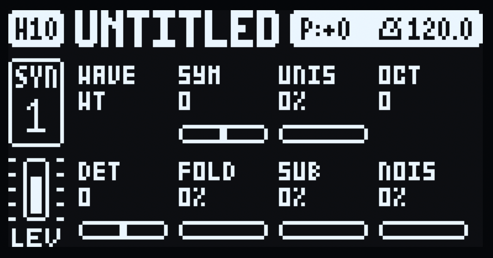
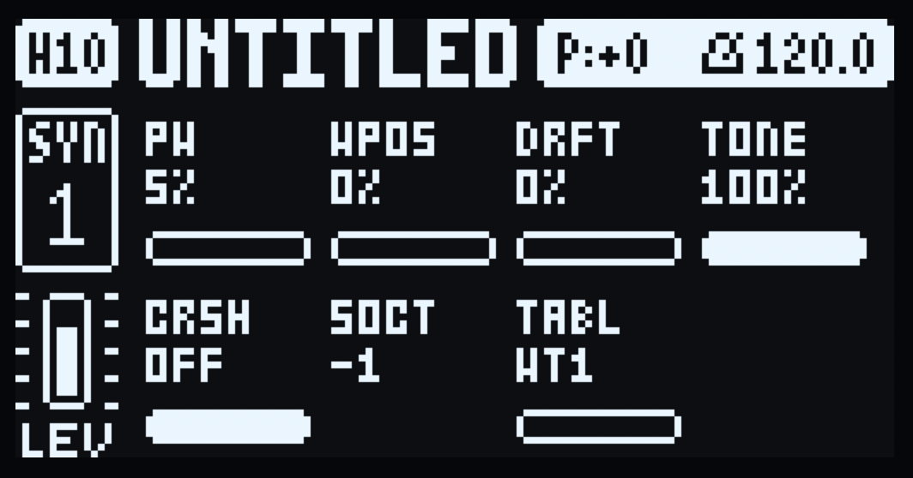

# VAWT - a virtual-analogue + wavetable machine for the Digitone mk1

A machine mod for the Elektron Digitone mk1 / Digitone Keys (OS 1.43 and 1.44).
It adds a non-FM sound engine: saw/square/pulse/triangle/sine
VA oscillators, a wavetable oscillator with bank switching (24 banks, all
replaceable - factory ships 24 bundled tables), a sub osc, white noise, a wavefolder, bitcrush and
a lowpass - played through the Digitone's own multimode filter, mixer, effects
and AMP envelope, like FM.

| SYN1 page | SYN2 page |
|---|---|
|  |  |

Pick it per track from MACHINES (hold a track key T1–T4), like any machine.
A sound's machine is stored in its sound slot 0, so sound locks switch engines
per trig, and p-locks, LFOs, MIDI CC and presets work on its knobs as on FM.
Polyphony safety fuse: VAWT is monophonic - at most 1 VAWT note renders at
once (newest note wins) - further simultaneous notes stay silent until the
slot frees.

## Controls

SYN1's first page and SYN2's first page become VAWT's (second pages stay FM's
and show blank). All values are the stock parameters', so everything persists
with the sound. Coarse tuning is OCT in whole octaves; fine transpose lives on
the TRIG page. Knob D is our own parameter 182 (stock 110 only spans 0–2); the
overlay's tick points SYN1-D at 182 on a VAWT track and back at stock 110 on an
FM one, since the page table is shared and built once. Knob A stays the stock
parameter 107, whose 0–7 range is the documented 1–8. If a knob misbehaves on
sounds from older builds, re-pick VAWT from MACHINES to reset the sound.

SYN1 (top row left to right, then bottom row):

- **A - WAVE** (box reads 1–8): the oscillator. 1 SAW, 2 SQU (square),
  3 PLS (pulse), 4 TRI (triangle), 5 SIN (sine), 6 WT (wavetable, see TABL),
  7 NOI (noise), 8 off (main oscillator silent - play SUB and NOIS alone).
  Stock parameter 107; FM tracks keep stock ALGO untouched. (`param:183`, a
  0–6 clone that would drop the silent 8th slot, is minted but not bound.)
- **B - SYM** (blank dial): wavefolder symmetry −100…+100%, middle = symmetric
  folds. Offsets the fold for even harmonics and lopsided folding; pairs with
  FOLD. Only audible when the folder works (FOLD up and/or SYM off middle).
- **C - UNIS** (blank dial): second-oscillator mix 0–100%. A detuned twin of
  the same wave; 0 = single oscillator.
- **D - OCT**: octave −2 / −1 / 0 / +1 / +2. Coarse tuning. Stops at both ends.
- **E - DET**: twin-oscillator detune, ±52 cents, middle = in tune. Only audible
  with UNIS turned up.
- **F - FOLD**: wavefolder 0–100%. Folds the waveform back on itself for
  brighter, harsher harmonics.
- **G - SUB**: rounded-square sub level 0–100%, an octave below (see SOCT).
  Mostly square so it cuts through, with triangle mixed in to round the edges.
- **H - NOIS**: white-noise level 0–100%, full-strength at max.

SYN2 (short labels; the envelope graphs are FM leftovers that do nothing):

- **A - PW**: pulse width 5–95%. Only shapes SQU and PLS.
- **B - WPO (= WPOS)**: wavetable position 0–100%. Set WAVE to 6 (WT), then turn
  this to morph through the TABLE bank's 8 frames. Does nothing on other waves.
- **C - DRF (= DRFT)**: analog pitch drift 0–100%. Slow random detune.
- **D - TON (= TONE)**: lowpass 0–100%. Full = wide open.
- **CRS (= CRSH)**: crusher, OFF at full clockwise, then 12-bit/18 kHz down to
  4-bit/5 kHz as it turns down. Depth and rate degrade together.
- **SOC (= SOCT)**: sub octave −2 / −1 / 0, relative to the oscillator.
- **TABL (= TABLE)**: wavetable bank 1–24. Instant switch, persists and p-locks
  like any knob. Bake a folder of your own instead: `docs/custom-tables.md`.
- **P**: unused.

The "RATIO" heading, SYN1's algorithm diagram and SYN2's envelope graphs are FM
leftovers the framework cannot redraw per track. WAVE's 1–8 map above; the rest
show their native graphics.

## LFOs

Both system LFOs modulate all 15 VAWT SYN slots, like on FM - FM tracks are
unaffected. The destination list still shows FM names (upstream limit), but each
entry targets the same sound slot VAWT uses, so pick by position: e.g. HARM moves
DET, ALGO moves WAVE, and so on down the SYN knob order. Depth adds to the knob
value and clamps at the knob's stock range. FILTER and AMP destinations are not
applied in the VAWT render - they act downstream in the Digitone's filter/mix,
as on FM.

## Signal path

```
OSC1 (WAVE @ pitch+OCT+drift) ────────┐
OSC2 (same WAVE, +DET, +drift) ───mix─┤─→ fold → crush → lowpass → out
SUB rounded-square (@ sub octave) ────┤         (then Digitone filter/mix/FX,
white noise ──────────────────────────┘          AMP envelope + velocity)
```

Output peaks at `DNM_PEAK`, about as loud as FM at stock defaults. Zeroed stages
are skipped exactly, so a default patch costs well under a full one.

## Status

- Host DSP tests pass (`python3 tools/vawt_host_test.py`, 40 checks - needs an
  elekloader checkout at `tools/elekloader` for headers only, no stock needed):
  pitch, octave, transpose, fold, wavetable morph and bank switching, pulse
  width, sub, noise, tone, crush, levels, bounds, plus both system LFOs to VAWT
  SYN slots (OCT doubling, FOLD, clamp, FILTER-ignore). LFO destinations show FM
  names but modulate the same slots; FILTER/AMP LFOs work downstream as on FM.
- Emulator: boots in digiemu vs stock.
- Hardware: tested on a Digitone mk1 (1.43 and 1.44 builds); flash at your own
  risk. The bootloader is never touched, so the stock `.syx` always recovers the
  unit (FUNC on power-up → TRIG 4 OS UPGRADE).

## Build

You need the stock OS `.syx` (Elektron's download), the m68k toolchain, and an
elekloader checkout at `tools/elekloader` with core/machines sources (separate
project, not included here):

```sh
export ELEKLOADER_CROSS=m68k-elf-
STOCK=path/to/Digitone_and_Digitone_Keys_OS1.43.syx
EL=tools/elekloader
python3 -m elekloader.sdk.build $EL/mods/core-dn1 --stock $STOCK
python3 -m elekloader.sdk.build $EL/mods/machines-dn1 --stock $STOCK
python3 -m elekloader.sdk.build vawt --stock $STOCK
# or: sh scripts/build.sh $STOCK
```

`scripts/build.sh` builds all three and lints + patches a test image into `out/`
(local build output only, not in git).

Bake your own wavetables: `docs/custom-tables.md`.

## Pages

On a VAWT track the SYN1/SYN2 content is fully ours: an 8-knob grid per page with
our labels, true value texts and mini bars, tracked from the kit every frame
(p-locks and presets included). The last-turned encoder's cell gets a frame.
Title bar, left rail and status stay stock.

Gating uses firmware state, not pixels: paint only when the active track's sound
plays VAWT, the showing key is SYN1/SYN2, no screen sits over the pages, and the
shown view is on its first page. Holding a sequencer step keeps the overlay up
and shows that step's parameter locks instead of the kit (hardware-proven
slot-indexed, inverted where locked). Holds address steps only in GRID or STEP
record; otherwise the trigs play notes and the kit shows, as stock. Copy/paste/
clear toasts yield the frame while the firmware's message shows. `ev_tick`
re-arms the frame only when something shown changed, so the UI idles when nothing
moves.

Known limits (upstream, not VAWT): the turn popup's long name, the LFO
destination lists and the page group headings read the stock parameter records,
so a turned DET reports `Harmonics=…` and WAVE reports `Algorithm=…` up top.
Only the name stays FM's - a machine mod cannot rename those per track.

## Files

| | |
|---|---|
| `vawt/mod.json` | the mod (machine id 10, needs core 3.1 + machines) |
| `vawt/vawt.c` | the engine |
| `vawt/overlay.c` | the `ev_tick`/`ev_draw`/`ev_key`/`ev_enc` overlay |
| `vawt/wt_tables.h` | wavetable data (24 bundled tables, all replaceable) |
| `tools/generate_wt.py` | regenerates `wt_tables.h` (your own folder via `docs/custom-tables.md`) |
| `tools/build-tables.py` | builds a custom `.elemod` from your own `.wav` folder |
| `tools/vawt_host_test.py` | host DSP tests, no stock needed (needs elekloader headers) |
| `scripts/build.sh` | build + lint + patch for 1.43 and 1.44 |
| `scripts/keys-vawt.txt` | emulator feature script for fwcheck |
| `docs/custom-tables.md` | build your own wavetable `.elemod` |
| `docs/bank-hold.md` | upstream hold-to-menu issue and fix |
| `preview/` | UI screenshots (SYN1, SYN2) |

Licence: GPL-2.0-or-later. Unofficial, not affiliated with Elektron.
